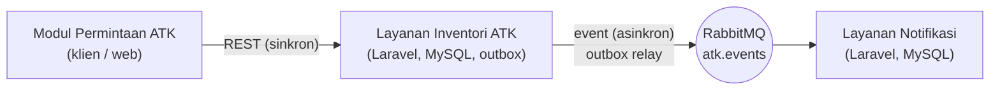

# Sistem Inventori ATK — PT Ina Nata Boga

Proyek akhir mata kuliah **Integrasi Sistem dan Komputasi Awan (25IF1504)**. Sistem mencatat barang ATK,
stok, serta permintaan ATK di gudang Purchasing/ATK PT Ina Nata Boga, dan memberi tahu pihak terkait
lewat layanan notifikasi.

## Arsitektur



| Layanan | Tanggung jawab | Basis data |
| --- | --- | --- |
| Layanan Inventori ATK (`inventori-atk`) | Barang, stok, riwayat stok, permintaan, persetujuan, outbox; menyediakan REST API | MySQL sendiri |
| Layanan Notifikasi (`layanan-notifikasi`) | Menerima event, mencatat notifikasi secara idempoten, peringatan stok menipis | MySQL sendiri |
| RabbitMQ | Message broker, exchange `atk.events` | — |

Modul Permintaan ATK adalah klien REST dari Layanan Inventori. Kontrak REST ada di
`inventori-atk/openapi.yaml`, kontrak event di [`docs/kontrak-event.md`](docs/kontrak-event.md).

## Isi repositori

| Folder / berkas | Isi |
| --- | --- |
| `inventori-atk/` | Layanan Inventori ATK (Laravel + Sail), `openapi.yaml`, feature test |
| `layanan-notifikasi/` | Layanan Notifikasi (Laravel + Sail), consumer RabbitMQ, test handler |
| `docs/kontrak-event.md` | Kontrak event: nama, exchange, routing key, field dan tipe, penerbit, penerima |
| `siapkan.sh` | Skrip penyiapan `.env`, dependensi, migrasi, dan test untuk kedua layanan |

## Prasyarat

Windows: WSL2 + Ubuntu, Docker Desktop (WSL Integration untuk Ubuntu aktif), Git. macOS/Linux: Docker dan Git.
Semua perintah dijalankan di terminal Ubuntu (WSL). Simpan repositori di home Linux (`~`), bukan di `/mnt/c`.

## Menjalankan dari nol

```bash
git clone <URL-REPOSITORI> proyek-iska
cd proyek-iska

# 1. Pasang dependensi PHP kedua layanan (tanpa PHP lokal)
for d in inventori-atk layanan-notifikasi; do
  docker run --rm -u "$(id -u):$(id -g)" -v "$PWD/$d:/var/www/html" -w /var/www/html \
    composer:latest composer install --ignore-platform-reqs --no-interaction
  cp -n "$d/.env.example" "$d/.env"
done

# 2. Siapkan .env, jalankan container, kunci aplikasi, composer require, migrasi, dan test
bash siapkan.sh
```

Setelah itu:

| Layanan | Alamat |
| --- | --- |
| Inventori ATK (REST) | `http://localhost/api/v1/barang` |
| Layanan Notifikasi | `http://localhost:8081` |
| RabbitMQ Management | `http://localhost:15672` (user `atk`, password `atk`) |

> Bila port 80 dipakai aplikasi lain, tambahkan `APP_PORT=8000` di `inventori-atk/.env`, lalu
> `./vendor/bin/sail up -d` ulang dan pakai `http://localhost:8000`.

Perintah harian (di folder masing-masing layanan): `./vendor/bin/sail up -d`, `./vendor/bin/sail down`,
`./vendor/bin/sail artisan ...`.

## Menjalankan test

```bash
cd inventori-atk      && ./vendor/bin/sail artisan test
cd ../layanan-notifikasi && ./vendor/bin/sail artisan test
```

Test memakai SQLite di memori (lihat `phpunit.xml`), terpisah dari MySQL. Test Inventori memeriksa kontrak REST
(status code, header `Location`, Problem Details, aturan stok) dan outbox/relay (dengan publisher yang di-mock);
test Notifikasi memeriksa handler idempoten.

## Memeriksa kontrak OpenAPI

```bash
cd inventori-atk
docker run --rm -v "$(pwd)":/work -w /work stoplight/spectral lint openapi.yaml
docker run --rm -p 8080:8080 -e SWAGGER_JSON=/spec/openapi.yaml -v "$(pwd)":/spec swaggerapi/swagger-ui
```

Lint harus tanpa error. Swagger UI terbuka di `http://localhost:8080`.

## Mencoba alur lengkap

Buka tiga terminal.

```bash
# Terminal 1 — relay outbox (menerbitkan event ke RabbitMQ)
cd inventori-atk && ./vendor/bin/sail artisan outbox:relay --terus

# Terminal 2 — consumer notifikasi permintaan
cd layanan-notifikasi && ./vendor/bin/sail artisan notifikasi:permintaan

# Terminal 3 — consumer peringatan stok
cd layanan-notifikasi && ./vendor/bin/sail artisan notifikasi:stok
```

Terminal 4 (permintaan HTTP; ganti `localhost` bila memakai `APP_PORT`):

```bash
# Tambah barang, lalu tambah stok
curl -s -X POST localhost/api/v1/barang -H 'Content-Type: application/json' -H 'Accept: application/json' \
  -d '{"kode":"ATK-001","nama":"Kertas A4 80 gram","satuan":"rim","stok_minimum":5}'
curl -s -X POST localhost/api/v1/barang/ATK-001/penyesuaian-stok -H 'Content-Type: application/json' -H 'Accept: application/json' \
  -d '{"perubahan":10,"alasan":"barang_masuk"}'

# Ajukan dan setujui permintaan
curl -s -X POST localhost/api/v1/permintaan -H 'Content-Type: application/json' -H 'Accept: application/json' \
  -d '{"pemohon":"Budi Santoso","bagian":"Finance","kode_barang":"ATK-001","jumlah":7}'
curl -s -X POST localhost/api/v1/permintaan/PRM-0001/persetujuan -H 'Content-Type: application/json' -H 'Accept: application/json' \
  -d '{"disetujui_oleh":"Petugas Gudang"}'
```

Hasil yang diharapkan: consumer permintaan menampilkan "Dicatat" untuk permintaan baru dan persetujuan; consumer
stok menampilkan peringatan menipis (stok tersisa 3, minimum 5). Isi notifikasi bisa dilihat di tabel
`log_notifikasi` pada Layanan Notifikasi.

## Hasil Pengujian

| No. | Pengujian | Hasil |
|---|---|---|
| 1 | Feature test Layanan Inventori | 20 lulus (93 assertion) |
| 2 | Feature test Layanan Notifikasi | 8 lulus (13 assertion) |
| 3 | Ajukan permintaan (REST) | 201, nomor PRM-0002, status diajukan |
| 4 | Isi tidak valid (REST) | 422 dengan Problem Details |
| 5 | Pengujian 404 dan 409 | Lulus di feature test |
| 6 | Event diterima consumer | Dicatat ke `log_notifikasi` |
| 7 | Pengiriman ulang dari Outbox | Dilewati (duplikat), log tidak bertambah |

## Anggota dan pembagian tugas

| Anggota | Peran |
| --- | --- |
| Gilbert Nicholas Petrusci | Ketua kelompok |
| Agnes Sarah Sabrina | Anggota |
| Angga Firmansyah | Anggota |
| Cindy Yulianti | Anggota |

| Bidang | Penanggung jawab |
| --- | --- |
| Kontrak OpenAPI, Swagger UI, review kontrak | _Gilbert_ |
| Layanan Inventori: REST API dan feature test | _Angga_ |
| RabbitMQ, event, consumer Layanan Notifikasi | _Cindy_ |
| Transactional outbox, dokumen analisis, slides | _Agnes_ |

## Catatan desain

- **Design-first:** `openapi.yaml` ditulis sebelum kode dan test; galat memakai Problem Details (RFC 9457).
- **Database per layanan:** tiap layanan hanya mengakses basis datanya sendiri; layanan lain hanya lewat REST atau event.
- **Outbox:** Layanan Inventori tidak memanggil RabbitMQ di dalam request. Perubahan data dan pesan outbox disimpan dalam satu
  transaksi, sehingga event tidak hilang walau broker mati.
- Sistem Accurate tidak termasuk dalam integrasi karena kelompok tidak memiliki akses ke sistem tersebut.
